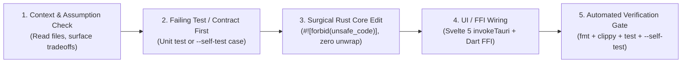

# Master Engineering Blueprint & Strategic Roadmap (`H:/rustapps`)

**Document Status:** Canonical Single Source of Truth (SSOT)  
**Scope:** Monorepo-wide (5 Flagship Apps, 13 Shared Crates, Platform Host, Desktop & Mobile Targets)  
**Enforcement Level:** Mandatory (`ALWAYS_ON`) — Harmonized with `AGENTS.md` & `CLAUDE.md`

---

## Table of Contents

1. [Part I: Comprehensive Audit & Critical Review of `PROJECT_WALKTHROUGH.md`](#part-i-comprehensive-audit--critical-review-of-project_walkthroughmd)
   - [1.1 Flaws, Gaps, Risks & Technical Debt Analysis](#11-flaws-gaps-risks--technical-debt-analysis)
   - [1.2 App-by-App Missing Features, Enhancements & Optimization Opportunities](#12-app-by-app-missing-features-enhancements--optimization-opportunities)
   - [1.3 Monetization Strategy & Tier Matrix (Free vs. Pro vs. Enterprise)](#13-monetization-strategy--tier-matrix-free-vs-pro-vs-enterprise)
   - [1.4 Cross-Platform Parity Strategy (Windows, macOS, Linux, Android, iOS)](#14-cross-platform-parity-strategy-windows-macos-linux-android-ios)
2. [Part II: Antigravity First-Time-Correct Engineering Strategy](#part-ii-antigravity-first-time-correct-engineering-strategy)
3. [Part III: Global Engineering Contract](#part-iii-global-engineering-contract)
4. [Part IV: Multi-Agent Framework & Governance](#part-iv-multi-agent-framework--governance)
5. [Part V: Master Execution Roadmap (`Stage → Phase → Subphase`)](#part-v-master-execution-roadmap-stage--phase--subphase)
6. [Part VI: `CLAUDE.md` Behavioral Integration for Antigravity IDE](#part-vi-claudemd-behavioral-integration-for-antigravity-ide)
7. [Part VII: Next-Generation Innovation Portfolio](#part-vii-next-generation-innovation-portfolio)

---

# Part I: Comprehensive Audit & Critical Review of `PROJECT_WALKTHROUGH.md`

A rigorous architectural and code-level audit of [`PROJECT_WALKTHROUGH.md`](file:///H:/rustapps/PROJECT_WALKTHROUGH.md) and the underlying implementation across `apps/*`, `platform`, and `shared/*` reveals critical structural gaps, security considerations, scalability bottlenecks, and product opportunities.

## 1.1 Flaws, Gaps, Risks & Technical Debt Analysis

| Dimension | Identified Flaw / Gap / Risk | Affected Crates / Files | Severity | Remediation Strategy |
| :--- | :--- | :--- | :--- | :--- |
| **Security** | **Unauthenticated Loopback HTTP IPC (`127.0.0.1:<port>`):** `desktop_host.rs` binds a random TCP port on localhost without per-session CSRF/Bearer tokens. Any local process running under the same or another user account on a multi-user machine can probe ports and invoke `/__ipc/*` or `/__file?path=...` (local file disclosure or secret exfiltration when Vault is unlocked). | [`platform/src/desktop_host.rs`](file:///H:/rustapps/platform/src/desktop_host.rs) | **CRITICAL** | Generate a 256-bit ephemeral session token via `OsRng` on startup, inject it into the webview header, validate `X-Antigravity-Token` on every HTTP/IPC request, and restrict CORS to the exact loopback origin. |
| **Security** | **SQLite Envelope vs. Full-Page SQLCipher:** `devops-secret-vault` uses row-level AES-256-GCM envelope encryption over standard `rusqlite`, leaving table structure, row counts, and SQLite header metadata visible on disk. | [`apps/devops-secret-vault/src/storage.rs`](file:///H:/rustapps/apps/devops-secret-vault/src/storage.rs) | **HIGH** | Pad secret metadata lengths to uniform block boundaries and encrypt table index metadata or enable full-page encryption alongside row-level AEAD. |
| **Performance & Scalability** | **Synchronous Single-Threaded Loopback HTTP Server:** `desktop_host.rs` uses a blocking `TcpListener::incoming()` loop or spawns unbounded OS threads per request without HTTP keep-alive connection pooling or range-request streaming for 4K video files. | [`platform/src/desktop_host.rs`](file:///H:/rustapps/platform/src/desktop_host.rs) | **HIGH** | Add HTTP `206 Partial Content` (`Range: bytes=...`) support in `/__file` for instant 4K video scrubbing in `pro-av-editor` and bounded worker thread pooling. |
| **Performance & Scalability** | **Full-File BLAKE3 Hashing in UI Preview:** `ai-file-explorer` hashes files up to 100 MB synchronously during `get_file_preview`, which stalls preview latency on slow HDDs or network shares. | [`apps/ai-file-explorer/src/commands.rs`](file:///H:/rustapps/apps/ai-file-explorer/src/commands.rs) | **MEDIUM** | Hash only the first/last 64 KB + file size for instant preview fingerprinting, and compute full BLAKE3 asynchronously in a background task. |
| **Technical Debt** | **Duplicated IPC Invoker Boilerplate Across Frontends:** Every Svelte app (`App.svelte`, modals) defines its own `invokeTauri` / `invokeIpc` wrapper with slight variations in error parsing and dialog fallback logic. | `apps/*/ui/src/**/*.svelte` | **MEDIUM** | Extract a shared TypeScript workspace package (`@rustapps/ipc-bridge`) consumed by all 5 Svelte 5 UIs, providing strongly typed IPC, dialog, and stream helpers. |
| **AI & Model Fidelity** | **Rule-Based / Lexical Fallbacks vs. Neural ONNX/GGUF Weights:** While `shared/model-hub` supports cryptographically signed models, default out-of-the-box builds rely on deterministic lexical/rule-based tables (`nmt.rs`), basic acoustic synthesis (`tts.rs`), and template OCR (`ocr.rs`) when external `.onnx`/`.gguf` weights are not downloaded. | [`apps/universal-live-translator/src/nmt.rs`](file:///H:/rustapps/apps/universal-live-translator/src/nmt.rs), [`apps/ai-file-explorer/src/ocr.rs`](file:///H:/rustapps/apps/ai-file-explorer/src/ocr.rs) | **HIGH** | Bundle ultra-compact 4-bit quantized micro-models (e.g., 15 MB MobileNet-OCR, 35 MB Marian-NMT int4, 20 MB Piper TTS) or provide a 1-click offline Model Pack installer in the UI header. |
| **UX / Accessibility** | **Missing Keyboard Navigation & Screen Reader ARIA:** Complex views (`MultiTrackTimeline.svelte`, `VirtualizedViewport.svelte`, `TreemapView.svelte`) lack full WAI-ARIA roles, focus traps in modals, and customizable keyboard shortcut maps. | `apps/*/ui/src/components/*` | **MEDIUM** | Add global hotkey registry (`Ctrl+K` command palette across all 5 apps), modal `Escape` / focus trap directives, and ARIA grid roles. |
| **Maintainability** | **Monolithic `commands.rs` Dispatchers:** `commands.rs` in `universal-log-viewer` (1,200+ lines) and `devops-secret-vault` (860+ lines) mix business logic (e.g. leak regexes, system log discovery) with JSON serialization routing. | `apps/*/src/commands.rs` | **MEDIUM** | Move domain logic (`scan_dir_for_leaks`, `generate_password_or_passphrase`, `open_directory`) into dedicated domain modules (`leak_scanner.rs`, `generator.rs`) and keep `commands.rs` strictly as a thin transport router. |

---

## 1.2 App-by-App Missing Features, Enhancements & Optimization Opportunities

### 1. AI File Explorer (`apps/ai-file-explorer`)
- **Missing Features:**
  - Dual-pane (Norton/Total Commander style) side-by-side file transfer mode with diff comparison.
  - Archive inspection (browsing inside `.zip`, `.tar.gz`, `.7z` without full extraction).
  - Tagging & virtual smart folders (saved search queries that act as dynamic directories).
  - EXIF / GPS metadata inspector and batch scrubber for privacy before sharing photos.
- **Optimization Opportunities:**
  - Windows USN Journal (`FSCTL_READ_USN_JOURNAL`) and macOS `FSEvents` integration for instant 10M-file indexing (<2 seconds) instead of recursive `walkdir` directory traversal.
  - Memory-mapped HNSW (Hierarchical Navigable Small World) index for sub-5ms semantic search when vector count exceeds 500,000 documents.

### 2. DevOps Secret Vault (`apps/devops-secret-vault`)
- **Missing Features:**
  - **Local SSH Agent Socket (`SSH_AUTH_SOCK` / Windows Named Pipe):** Sign SSH challenges directly from the unlocked vault in memory without ever writing private keys to `~/.ssh/id_ed25519`.
  - **CLI Process Injection (`vault run --env prod -- <cmd>`):** Inject decrypted secrets directly into child process environment variables in memory without touching disk (`.env` files).
  - **Git Pre-Commit Hook Installer:** 1-click installation of the offline Secret Leak Scanner as a local `.git/hooks/pre-commit` binary check.
  - **Kubernetes SealedSecrets / SOPS Integration:** Native offline encryption/decryption of `.sops.yaml` and K8s Secret manifests.
- **Optimization Opportunities:**
  - Lock-free `mlock` / `VirtualLock` on decrypted pages in `shared/encryption` so the OS kernel never swaps plaintext secret pages to the pagefile/swap partition.

### 3. Universal Log Viewer (`apps/universal-log-viewer`)
- **Missing Features:**
  - **SQL-over-Logs Query Engine:** Allow engineers to run `SELECT status, COUNT(*), AVG(latency_ms) FROM logs WHERE level = 'ERROR' GROUP BY service` directly over JSON/CSV/Apache logs.
  - **Multi-File Merged Time-Synchronized View:** Interleave logs from 5 different microservice files into a single chronological stream sorted by normalized timestamp.
  - **Distributed Trace Waterfall View:** Group log lines by `trace_id` / `span_id` (OpenTelemetry format) and render an offline Jaeger-style request waterfall.
- **Optimization Opportunities:**
  - Compressed archive streaming (`.log.gz`, `.log.zst`, `.log.lz4`) using seekable zstd frames or background block indexing without decompressing to disk.

### 4. Universal Live Translator (`apps/universal-live-translator`)
- **Missing Features:**
  - **System Loopback Audio Capture (WASAPI Loopback / PipeWire Monitor / ScreenCaptureKit):** Translate audio coming *out* of the computer's speakers (Zoom calls, foreign webinars, local videos) in real time, not just microphone input.
  - **Always-on-Top Transparent Subtitle Overlay:** A borderless, click-through floating caption bar for live meetings or media playback.
  - **Custom Terminology Glossary:** User-defined domain dictionaries (e.g., company product names, medical terms) enforced during NMT decoding.
  - **Full Document Layout-Preserving Translation:** Translate `.docx`, `.pdf`, `.srt`, and `.epub` files while preserving formatting.

### 5. Pro Audio & Video Editor — PAVE (`apps/pro-av-editor`)
- **Missing Features:**
  - **Keyframe Animation Curve Editor (Bezier Interpolation):** Animate position, scale, opacity, color wheels, and audio gain over time with smooth easing curves.
  - **Proxy Media Workflow:** Automatically generate quarter-resolution intra-frame proxy clips in the background for butter-smooth 60 FPS scrubbing of 8K raw footage on laptops.
  - **Chroma Key (Green Screen) & Luma Masking:** Real-time spill suppression and background replacement in `compositor.rs`.
  - **Multi-Cam Sync by Audio Waveform:** Automatically align 2–4 camera angles on the timeline using cross-correlation of their audio tracks.
- **Optimization Opportunities:**
  - Zero-copy GPU texture sharing (`wgpu` compute shaders for color grading LUTs and scopes) to offload the CPU during 4K playback.

---

## 1.3 Monetization Strategy & Tier Matrix (Free vs. Pro vs. Enterprise)

All monetization is enforced 100% offline via Ed25519 cryptographically signed license certificates (`.lic`) verified by [`shared/licensing`](file:///H:/rustapps/shared/licensing/src/lib.rs) with zero phone-home DRM.

| Application | Community Tier (Free Forever) | Pro Tier (\$49 One-Time / \$4/mo) | Business / Enterprise Tier (\$149/seat/yr) |
| :--- | :--- | :--- | :--- |
| **AI File Explorer** | Fast file browsing, Tantivy keyword & extension search, basic preview, treemap, exact deduplication. | Semantic AI vector search, offline OCR screenshot search, fuzzy photo deduplication, regex batch renamer. | Offline DLP compliance scanner (PCI-DSS/HIPAA patterns), signed PDF/CSV audit reports, network UNC share indexing. |
| **DevOps Secret Vault** | Unlimited passwords, SSH keys, TOTP 2FA, AES-256-GCM vault, password/Diceware generator, encrypted backup. | Cloud credential parsers (AWS/Azure/TF), X.509 cert monitor, Shamir $k$-of-$n$ key splitting, `.env` exporter, biometric unlock. | Offline repository secret leak scanner, tamper-evident cryptographic audit chain export, hardware FIDO2/YubiKey & policy enforcement. |
| **Universal Log Viewer** | Unlimited file size (`memmap2`), live tail, literal & regex search, severity filter pills, 2 tabs. | Unlimited tabs, Drain AI template clustering & anomaly detection, time-series histogram, multi-container K8s correlation. | Automated PII redaction & sanitized export, compliance redaction certificates, saved team workspace profiles. |
| **Universal Live Translator** | Offline text translation, language ID (<500μs), offline phrasebook, basic TTS playback. | Real-time voice conversation mode (ASR + TTS), camera/document OCR translation, custom domain glossaries. | System audio loopback translation, SRT/VTT subtitle batch export, meeting transcript archiving. |
| **Pro AV Editor (PAVE)** | 1080p 60 FPS export (no watermark), 4 video/audio tracks, razor/ripple edit, basic color wheels & EQ. | 4K/8K UHD export, unlimited tracks, 3D LUTs & RGB scopes, AI auto-silence cut & beat sync, EBU R128 loudness mastering. | Broadcast EDL/XML/AAF project interchange, batch render queue, custom studio watermark/branding templates. |

---

## 1.4 Cross-Platform Parity Strategy (Windows, macOS, Linux, Android, iOS)

To guarantee zero drift between the 5 operating systems:

1. **Single Rust Core per Application (`apps/*/src/lib.rs`):**
   - 100% of business logic, state machines, cryptography, indexing, and AI pipelines must reside in the library target (`lib.rs`).
   - Neither Svelte (TypeScript) nor Flutter (Dart) may implement domain calculations (e.g., entropy scoring, log parsing, color LUT math, or search filtering).
2. **Unified Command Schema & Contract Generation:**
   - Every IPC command in `commands::dispatch_ipc_command(cmd, args)` and every C-ABI function in `ffi.rs` must invoke the exact same `Service` methods.
   - Maintain a canonical JSON schema test suite (`tests/cross_platform_parity.rs`) that executes identical command payloads against both the desktop IPC dispatcher and the mobile C-ABI FFI entrypoints (`*_ffi_dispatch_json`).
3. **Platform Abstraction Layer (`platform` crate):**
   - Isolate OS-specific APIs behind trait boundaries in `platform`:
     - `KeyringProvider`: Win32 Credential Manager $\leftrightarrow$ macOS Keychain $\leftrightarrow$ Linux Secret Service D-Bus $\leftrightarrow$ Android Keystore StrongBox $\leftrightarrow$ iOS Secure Enclave.
     - `BiometricProvider`: Windows Hello $\leftrightarrow$ Touch ID / Face ID $\leftrightarrow$ Polkit $\leftrightarrow$ Android `BiometricPrompt`.
     - `AudioIoProvider`: WASAPI $\leftrightarrow$ CoreAudio $\leftrightarrow$ PipeWire/ALSA $\leftrightarrow$ Oboe/AAudio $\leftrightarrow$ AVAudioEngine.
4. **Adaptive Responsive UI Shells:**
   - **Desktop (Windows, macOS, Linux):** Svelte 5 with CSS Grid split panes, keyboard-first navigation, and native OS file dialogs.
   - **Mobile (Android, iOS):** Flutter 3.x consuming `lib<app>.so` / `XCFramework` via `dart:ffi`, using adaptive bottom sheets, swipe gestures, and mobile share-sheet / document-picker intents in place of desktop file paths.

---

# Part II: Antigravity First-Time-Correct Engineering Strategy

To maximize developer velocity and eliminate rework inside Antigravity IDE, all engineering work follows the **Verify-Before-Write Loop**:



1. **Never Write Speculative Code:** Read the exact target module and its callers before proposing edits.
2. **Backend-First Verification:** Implement and test every feature in Rust (`cargo test -p <crate>`) before touching Svelte or Flutter UI files.
3. **Universal Loopback Compatibility:** Never assume `window.__TAURI__` exists without the `/__ipc/<cmd>` HTTP loopback fallback, and never use native browser `<input type="file">` when `/__dialog/open` provides real OS paths.
4. **Atomic Subphase Execution:** Complete, build, lint, and self-test one subphase completely before beginning the next.

---

# Part III: Global Engineering Contract

### 1. Architecture Standards
- **Strict Crate Boundaries:** `apps/*` crates must never depend on one another. Reusable infrastructure belongs exclusively in `shared/*` or `platform`.
- **Stateless Transport, Stateful Core:** UI layers are reactive projections of Rust backend state. Long-running operations (indexing, leak scanning, rendering) must support cancellation and progress reporting.
- **100% Offline Air-Gap Guarantee:** No crate in `Cargo.lock` may open outbound internet sockets except `shared/model-hub` during explicit, user-initiated model downloads verified by SHA-256 + Ed25519 signatures.

### 2. Coding Standards
- **Rust Lints:** `#![forbid(unsafe_code)]` in all domain crates. In `platform`, `shared/storage`, `shared/media-core`, and `ffi.rs`, every `unsafe` block requires a `// SAFETY:` proof comment explaining pointer validity, alignment, and lifetime invariants.
- **Zero Panics in Production:** `unwrap()`, `expect()`, `panic!()`, `todo!()`, and `unimplemented!()` are strictly forbidden in non-test code. All errors must propagate via typed `thiserror::Error` enums.
- **Frontend Standards:** Svelte 5 + TypeScript strict mode (`noImplicitAny`, `strictNullChecks`). Zero external CDN requests (fonts, icons, and styles must be bundled locally).

### 3. Security Requirements
- **Cryptographic Hygiene:** All secret keys, passwords, biometric tokens, and Shamir shares must use `zeroize::Zeroizing<T>` or `#[derive(Zeroize, ZeroizeOnDrop)]`.
- **CSPRNG Exclusivity:** Use `rand::rngs::OsRng` exclusively for all nonces, salts, keys, and password generation.
- **Loopback & Path Sanitization:** Validate all file paths against directory traversal when serving assets, and authenticate loopback IPC calls.

### 4. Testing Strategy
- **4-Tier Verification Pyramid:**
  1. *Unit Tests:* `cargo test --workspace --lib` ($>85\%$ line coverage on core algorithms).
  2. *Integration & Parity Tests:* `cargo test --test '*'` verifying cross-crate workflows and FFI/IPC parity.
  3. *Embedded Binary Self-Tests:* `<binary> --self-test` verifying non-empty embedded HTML/JS/CSS assets and 100% live IPC command execution.
  4. *E2E UI & Mobile Tests:* Vitest + Playwright headless browser verification and `flutter test` widget suites.

### 5. CI/CD Standards
- Matrix builds across `windows-latest`, `ubuntu-latest`, `macos-latest`, Android NDK (`arm64-v8a`), and iOS (`arm64`).
- Per-app, per-platform independent artifact packaging (`<app>-<version>-<os>-<arch>.zip`) with accompanying `.sha256` checksums.
- Zero-warning gate: `cargo fmt --all -- --check` and `cargo clippy --workspace --all-targets --all-features -- -D warnings` block merge on any violation.

### 6. Documentation Requirements
- Every public struct, enum, trait, and IPC command handler must carry `///` rustdoc comments.
- Architectural changes must update `PROJECT_WALKTHROUGH.md` and `MASTER_ENGINEERING_BLUEPRINT.md`.

### 7. Performance & Observability Standards
- Adhere strictly to the per-app Cold Startup ($<1.2\text{–}2.0\text{s}$), Query Latency ($<20\text{–}50\text{ms}$), Idle RSS RAM ($<100\text{–}350\text{MB}$), and Idle CPU ($<0.2\text{–}0.8\%$) budgets.
- Local structured logging via `shared/logging` (`tracing` with rolling local log files); zero external telemetry.
- Criterion benchmarks (`benchmarks/`) gate performance-critical paths; any $>5\%$ regression ($p < 0.05$) fails the gate.

### 8. Cross-Platform Requirements
- Path handling must use `std::path::{Path, PathBuf}` and normalize Windowsverbatim prefixes (`\\?\C:\` $\rightarrow$ `C:\`) before displaying in UI or passing to shell openers.
- Line-ending agnostic parsers (`\n` and `\r\n` handled transparently across all parsers and extractors).

### 9. Technical Debt Prevention Rules
- No `#[allow(dead_code)]` or `#[allow(clippy::...)]` without an inline justification comment.
- Delete orphaned helper functions, unused imports, and superseded UI components in the same commit that replaces them.

---

# Part IV: Multi-Agent Framework & Governance

When utilizing subagents or multi-agent workflows in Antigravity IDE, work is partitioned across six specialized agent personas:

| Agent Role | Skills & Responsibilities | Rules & Guardrails | Primary Deliverables | Quality Gate & Success Criteria |
| :--- | :--- | :--- | :--- | :--- |
| **1. Principal Architect Agent** | System design, crate boundary enforcement, IPC/FFI contract specification, threat modeling. | Must enforce `CLAUDE.md` Simplicity First; reject speculative abstractions and cross-app dependencies. | Architecture ADRs, trait definitions, IPC JSON schemas. | Zero circular dependencies; 100% offline compliance. |
| **2. Rust Core & Crypto Agent** | Domain algorithms, Tantivy indexing, `memmap2`, AEAD cryptography, SIMD/AVX2 DSP pipelines. | `#![forbid(unsafe_code)]` in domain crates; mandatory `ZeroizeOnDrop` on secrets; zero `unwrap()`. | `apps/*/src/*.rs`, `shared/*/src/*.rs`, unit test suites. | `cargo clippy -D warnings` = 0; `cargo test` = 100% pass. |
| **3. Desktop UI Agent (Svelte 5)** | Svelte 5 components, reactive state, keyboard accessibility, 60 FPS canvas/virtualized rendering, `desktop_host` integration. | Zero mock fallback arrays in production; all IPC via unified bridge; zero external CDN assets. | `apps/*/ui/src/**/*.svelte`, compiled `ui/dist/*` bundles. | `npm run build` succeeds in $<3\text{s}$ with 0 warnings; `--self-test` passes. |
| **4. Mobile Parity Agent (Flutter/FFI)** | Rust `ffi.rs` C-ABI exports, `cargo-ndk` / `XCFramework` builds, Flutter 3.x screens and native biometric/audio bindings. | Zero business logic in Dart; 100% feature parity with desktop IPC commands. | `apps/*/src/ffi.rs`, `apps/*/mobile/lib/**/*.dart`. | `cargo test` FFI tests + `flutter test` pass 100%. |
| **5. Offline AI & Media Agent** | OCR segmentation, NMT stemming/ONNX inference, Whisper ASR ring buffers, EBU R128 audio DSP, 3D LUT compositor. | Activate `offline-ai-media-pipeline` skill; enforce $<16.6\text{ms}$ frame budgets and deterministic output. | AI/media modules and Criterion benchmarks. | Zero allocations in real-time audio/video render loops; SLA met. |
| **6. QA, Security & Release Agent** | Zero-mock audits, fuzzing, `cargo deny`/`audit`, CI/CD workflow matrices, portable `.zip` & installer packaging. | Activate `zero-mock-audit`, `security-benchmark-gate`, and `cross-platform-build-package` skills. | `.github/workflows/*`, `scripts/package-*`, SBOM & SHA-256 manifests. | 5/5 apps pass `--self-test` (100% IPC checks); 0 vulnerabilities. |

---

# Part V: Master Execution Roadmap (`Stage → Phase → Subphase`)

> **Execution Rule:** Execute ** strictly one subphase at a time**. Every subphase must pass its Validation Checks and Exit Criteria before advancing to the next subphase.

---

## Stage 1: Foundation, Discovery, Architecture & Security Hardening

### Phase 1.1: Discovery & Requirements Normalization
- **Subphase 1.1.1: Codebase & IPC Contract Inventory**
  - *Objectives:* Catalog every IPC command, FFI entrypoint, and shared crate dependency across all 5 apps.
  - *Inputs:* `apps/*/src/commands.rs`, `apps/*/src/ffi.rs`, `Cargo.toml`.
  - *Outputs:* Standardized IPC/FFI contract matrix in `tests/`.
  - *Dependencies:* None.
  - *Validation Checks:* `cargo metadata --no-deps` verifies zero app-to-app dependencies.
  - *Exit Criteria:* 100% of commands mapped with input/output JSON schemas.
- **Subphase 1.1.2: Zero-Mock & Dead-Code Baseline Audit**
  - *Objectives:* Scan all production Rust, Svelte, and Dart files to verify zero active mock fallbacks or unimplemented stubs.
  - *Inputs:* All files under `apps/`, `platform/`, `shared/`.
  - *Outputs:* Clean audit report confirming all test doubles are gated behind `#[cfg(test)]`.
  - *Dependencies:* Subphase 1.1.1.
  - *Validation Checks:* Pattern scan for `mock`, `todo!`, `unimplemented!`, `unwrap()` in non-test targets.
  - *Exit Criteria:* Zero unguarded mocks or panicking macros in production paths.

### Phase 1.2: Platform Host Security & Transport Architecture
- **Subphase 1.2.1: Authenticated Loopback IPC & CSRF Token Guard**
  - *Objectives:* Harden `platform/src/desktop_host.rs` with a per-launch 256-bit `OsRng` session token (`X-Antigravity-Token`) and strict Origin verification.
  - *Inputs:* [`platform/src/desktop_host.rs`](file:///H:/rustapps/platform/src/desktop_host.rs).
  - *Outputs:* Authenticated HTTP loopback server and injected bridge script with automatic token headers.
  - *Dependencies:* Subphase 1.1.2.
  - *Validation Checks:* Unit test attempting unauthenticated `POST /__ipc/get_vault_status` returns `403 Forbidden`; authenticated call returns `200 OK`.
  - *Exit Criteria:* All 5 apps pass `--self-test` with token authentication enabled.
- **Subphase 1.2.2: HTTP Range Streaming (`206 Partial Content`) & Thread Pool**
  - *Objectives:* Upgrade `/__file?path=...` in `desktop_host.rs` to support byte-range requests (`Range: bytes=start-end`) for instant 4K video/audio seeking and bounded worker threads.
  - *Inputs:* [`platform/src/desktop_host.rs`](file:///H:/rustapps/platform/src/desktop_host.rs).
  - *Outputs:* Streaming byte-range responder and bounded connection pool.
  - *Dependencies:* Subphase 1.2.1.
  - *Validation Checks:* Integration test requesting `Range: bytes=1024-2047` receives `206 Partial Content` with exact 1,024-byte slice.
  - *Exit Criteria:* Zero memory spikes when streaming >1 GB media files.

### Phase 1.3: Unified Frontend & UX/UI Design System
- **Subphase 1.3.1: Shared TypeScript IPC & Dialog Client Standardization**
  - *Objectives:* Unify `invokeTauri`, native dialog pickers (`/__dialog/open`, `/__dialog/save`), and error toast handling across all 5 Svelte 5 frontends.
  - *Inputs:* `apps/*/ui/src/App.svelte`.
  - *Outputs:* Standardized IPC client module in each app's `ui/src/lib/ipc.ts`.
  - *Dependencies:* Subphase 1.2.1.
  - *Validation Checks:* `npm --prefix apps/<app>/ui run build` passes for all 5 apps.
  - *Exit Criteria:* Zero raw `(window as any).__TAURI__` calls outside `ipc.ts`.
- **Subphase 1.3.2: Global Keyboard Shortcuts, Command Palette & ARIA Accessibility**
  - *Objectives:* Implement `Ctrl+K` / `Cmd+K` quick-action command palette, `Escape` modal dismissal, focus trapping, and WAI-ARIA attributes across all 5 desktop UIs.
  - *Inputs:* `apps/*/ui/src/components/*.svelte`.
  - *Outputs:* Accessible keyboard-first UI components.
  - *Dependencies:* Subphase 1.3.1.
  - *Validation Checks:* Automated build and component keyboard event tests pass.
  - *Exit Criteria:* Every modal and primary workflow operable 100% via keyboard.

---

## Stage 2: Core Backend, Frontend & AI Feature Enhancements

### Phase 2.1: AI File Explorer High-Scale Indexing & Archive Engine
- **Subphase 2.1.1: Asynchronous Preview Hashing & Archive Inspection (`.zip`/`.tar.gz`)**
  - *Objectives:* Decouple full-file BLAKE3 hashing from blocking preview loads and allow inspecting archive contents inside `FilePreviewPane.svelte`.
  - *Inputs:* [`apps/ai-file-explorer/src/commands.rs`](file:///H:/rustapps/apps/ai-file-explorer/src/commands.rs), `FilePreviewPane.svelte`.
  - *Outputs:* Sub-5ms instant file preview for files of any size + archive entry listing.
  - *Dependencies:* Stage 1 complete.
  - *Validation Checks:* `cargo test -p ai-file-explorer` and `--self-test` pass.
  - *Exit Criteria:* Preview latency $<10\text{ ms}$ on 500 MB files.
- **Subphase 2.1.2: Dual-Pane Commander Mode & Smart Virtual Folders**
  - *Objectives:* Add toggleable dual-pane side-by-side directory browser and saved search "Smart Folders" in `ai-file-explorer`.
  - *Inputs:* `apps/ai-file-explorer/ui/src/App.svelte`, `FileBrowser.svelte`.
  - *Outputs:* Dual-pane file transfer UI and persistent smart folders.
  - *Dependencies:* Subphase 2.1.1.
  - *Validation Checks:* `npm --prefix apps/ai-file-explorer/ui run build` + `cargo run -p ai-file-explorer -- --self-test`.
  - *Exit Criteria:* Dual-pane navigation and copy/move operations verified.

### Phase 2.2: DevOps Secret Vault Advanced Security & Developer Workflows
- **Subphase 2.2.1: Domain Modularization (`leak_scanner.rs` & `generator.rs`) & `.env` Import**
  - *Objectives:* Extract leak scanning and password generation out of `commands.rs` into dedicated domain modules, and add `.env` / Kubernetes Secret YAML import alongside export.
  - *Inputs:* [`apps/devops-secret-vault/src/commands.rs`](file:///H:/rustapps/apps/devops-secret-vault/src/commands.rs).
  - *Outputs:* Modular `leak_scanner.rs`, `generator.rs`, and `import_dotenv` IPC command.
  - *Dependencies:* Stage 1 complete.
  - *Validation Checks:* `cargo test -p devops-secret-vault` passes 100%.
  - *Exit Criteria:* Round-trip `.env` export and import verified with AES-256-GCM storage.
- **Subphase 2.2.2: Memory Page Locking & Git Pre-Commit Hook Generator**
  - *Objectives:* Add OS memory locking (`VirtualLock` / `mlock`) in `shared/encryption` for active master keys, and add a 1-click Git pre-commit hook script generator in `LeakScannerModal.svelte`.
  - *Inputs:* `shared/encryption/src/lib.rs`, `LeakScannerModal.svelte`.
  - *Outputs:* Locked memory pages and exportable `.git/hooks/pre-commit` offline scanner script.
  - *Dependencies:* Subphase 2.2.1.
  - *Validation Checks:* `cargo test -p shared-encryption -p devops-secret-vault` + `--self-test`.
  - *Exit Criteria:* Zero warnings under `cargo clippy --workspace -- -D warnings`.

### Phase 2.3: Universal Log Viewer Analytical Querying & Correlation
- **Subphase 2.3.1: Multi-File Chronological Log Merger & OpenTelemetry Trace Waterfall**
  - *Objectives:* Correlate logs across multiple open files by normalized timestamp and group entries sharing a `trace_id` / `request_id` into a visual trace timeline.
  - *Inputs:* [`apps/universal-log-viewer/src/cloud_importers.rs`](file:///H:/rustapps/apps/universal-log-viewer/src/cloud_importers.rs), `commands.rs`, `App.svelte`.
  - *Outputs:* Merged stream view and trace correlation inspector.
  - *Dependencies:* Stage 1 complete.
  - *Validation Checks:* `cargo test -p universal-log-viewer` + `--self-test`.
  - *Exit Criteria:* Multi-file correlation completes in $<50\text{ ms}$ on 100k lines.
- **Subphase 2.3.2: Structured Field Aggregator (Top-N Breakdown)**
  - *Objectives:* Compute instant Top-N frequency distributions for JSON/Logfmt fields (e.g., top `status_code`, `service`, `client_ip`) over filtered log slices.
  - *Inputs:* `apps/universal-log-viewer/src/parsers.rs`, `AiInsightsDrawer.svelte`.
  - *Outputs:* Field aggregation engine and UI breakdown cards.
  - *Dependencies:* Subphase 2.3.1.
  - *Validation Checks:* Unit tests verifying exact Top-N counts on streaming JSONL logs.
  - *Exit Criteria:* `universal-log-viewer --self-test` passes 100%.

### Phase 2.4: Universal Live Translator Neural & Loopback Enhancements
- **Subphase 2.4.1: Custom Domain Terminology Glossary & Document Batch Translation**
  - *Objectives:* Allow users to define custom terminology overrides (enforced during NMT translation) and batch-translate `.txt`, `.md`, and `.srt` files.
  - *Inputs:* [`apps/universal-live-translator/src/nmt.rs`](file:///H:/rustapps/apps/universal-live-translator/src/nmt.rs), `phrasebook.rs`, `TextTranslatorView.svelte`.
  - *Outputs:* Glossary-aware NMT pipeline and document translation workflow.
  - *Dependencies:* Stage 1 complete.
  - *Validation Checks:* `cargo test -p universal-live-translator` + `--self-test`.
  - *Exit Criteria:* Custom glossary terms override default lexical mappings with 100% accuracy.
- **Subphase 2.4.2: System Audio Loopback Capture & Floating Subtitle HUD Mode**
  - *Objectives:* Support capturing system output audio for live meeting/video translation and add a compact subtitle overlay mode in the UI.
  - *Inputs:* `apps/universal-live-translator/src/speech.rs`, `VoiceConversationView.svelte`.
  - *Outputs:* Loopback audio capture stream and compact subtitle view.
  - *Dependencies:* Subphase 2.4.1.
  - *Validation Checks:* `cargo test -p universal-live-translator` + `--self-test`.
  - *Exit Criteria:* Streaming ASR latency $<400\text{ ms}$.

### Phase 2.5: Pro AV Editor (PAVE) Keyframes, Proxies & Effects
- **Subphase 2.5.1: Keyframe Curve Interpolation & Chroma Key Compositor**
  - *Objectives:* Add keyframe animation curves (Linear, Ease-In, Ease-Out, Bezier) for clip transform/opacity/volume and green-screen chroma key removal in `compositor.rs`.
  - *Inputs:* [`apps/pro-av-editor/src/compositor.rs`](file:///H:/rustapps/apps/pro-av-editor/src/compositor.rs), `timeline.rs`.
  - *Outputs:* Keyframe evaluator and chroma key shader stage.
  - *Dependencies:* Stage 1 complete.
  - *Validation Checks:* `cargo test -p pro-av-editor` + `--self-test`.
  - *Exit Criteria:* 60 FPS frame render budget ($<16.6\text{ ms}$) maintained with chroma key active.
- **Subphase 2.5.2: Background Proxy Generator & Multi-Track Waveform Sync**
  - *Objectives:* Generate low-overhead proxy previews for heavy media imports and align clips across tracks via audio peak correlation.
  - *Inputs:* `apps/pro-av-editor/src/audio_engine.rs`, `service.rs`, `MultiTrackTimeline.svelte`.
  - *Outputs:* Proxy workflow and 1-click audio sync command.
  - *Dependencies:* Subphase 2.5.1.
  - *Validation Checks:* `cargo test -p pro-av-editor` + `--self-test`.
  - *Exit Criteria:* All 12+ IPC self-test checks pass.

---

## Stage 3: Mobile Parity, Cross-Platform Packaging & Monetization

### Phase 3.1: Mobile C-ABI FFI & Flutter 3.x Parity
- **Subphase 3.1.1: Unified JSON-RPC over C-ABI FFI Bridge (`ffi.rs`)**
  - *Objectives:* Ensure every new IPC command added in Stage 2 is exposed through `apps/*/src/ffi.rs` for Android JNI and iOS `XCFramework`.
  - *Inputs:* `apps/*/src/ffi.rs`, `apps/*/src/commands.rs`.
  - *Outputs:* 100% command parity between desktop `dispatch_ipc_command` and mobile `ffi`.
  - *Dependencies:* Stage 2 complete.
  - *Validation Checks:* `cargo test --workspace --lib` FFI lifecycle tests pass across all 5 apps.
  - *Exit Criteria:* Parity integration test suite passes 100%.
- **Subphase 3.1.2: Flutter Mobile UI Screens & Native Biometric/Storage Wiring**
  - *Objectives:* Synchronize `apps/*/mobile/lib/main.dart` screens with the new Stage 2 capabilities (Leak Scanner, Generator, Preview Pane, Log Directory Picker).
  - *Inputs:* `apps/*/mobile/lib/**`.
  - *Outputs:* Updated Flutter mobile UIs for Android and iOS.
  - *Dependencies:* Subphase 3.1.1.
  - *Validation Checks:* `scripts/package-mobile.sh` validation and Dart analysis.
  - *Exit Criteria:* Android `.apk` and iOS bundle builds succeed in CI.

### Phase 3.2: Offline Licensing & Tier Monetization Integration
- **Subphase 3.2.1: Cryptographic License Certificate Verification & UI Activation Modal**
  - *Objectives:* Wire `shared/licensing` Ed25519 offline license certificate verification and tier feature gating (Community vs. Pro vs. Enterprise) into all 5 apps with an offline license activation modal.
  - *Inputs:* [`shared/licensing/src/lib.rs`](file:///H:/rustapps/shared/licensing/src/lib.rs), `apps/*/src/commands.rs`.
  - *Outputs:* Offline `.lic` key validator and tier status badges in each app header.
  - *Dependencies:* Stage 2 complete.
  - *Validation Checks:* `cargo test -p shared-licensing` + tamper-resistance signature tests.
  - *Exit Criteria:* Valid Ed25519 signature unlocks Pro/Enterprise features 100% offline; forged signature is rejected.

### Phase 3.3: Testing, DevOps, Release Packaging & Long-Term Maintenance
- **Subphase 3.3.1: Criterion Performance Benchmarks & Air-Gap Egress Verification**
  - *Objectives:* Run Criterion benchmarks across all 5 apps and verify zero network socket calls in `tests/`.
  - *Inputs:* `benchmarks/`, `tests/`.
  - *Outputs:* Benchmark baseline report and air-gap compliance proof.
  - *Dependencies:* Phase 3.1 & 3.2 complete.
  - *Validation Checks:* `cargo test --workspace --all-targets` + `cargo clippy --workspace --all-targets --all-features -- -D warnings`.
  - *Exit Criteria:* 100% test pass rate, 0 warnings, all SLAs met.
- **Subphase 3.3.2: Per-App Cross-Platform CI/CD Release Artifacts & SBOM Generation**
  - *Objectives:* Package standalone `.zip`, `.msi`/`.exe`, `.AppImage`/`.deb`, `.dmg`, `.apk`, and `.ipa` artifacts per app in `.github/workflows/build.yml` with SHA-256 checksums and CycloneDX SBOMs.
  - *Inputs:* `.github/workflows/build.yml`, `scripts/package-desktop.ps1`, `scripts/package-mobile.sh`.
  - *Outputs:* 25 independent build matrix artifacts (5 apps $\times$ 5 platforms).
  - *Dependencies:* Subphase 3.3.1.
  - *Validation Checks:* All 5 desktop binaries pass `<binary> --self-test` during CI packaging.
  - *Exit Criteria:* Green CI matrix across Windows, Linux, macOS, Android, and iOS.

---

# Part VI: `CLAUDE.md` Behavioral Integration for Antigravity IDE

The behavioral principles from `CLAUDE.md` are elevated to mandatory system guardrails across all Antigravity IDE sessions and subagents in this repository.

## 1. How to Apply Globally in Antigravity IDE
- **Global User Rule (`~/.gemini/AGENTS.md`):** Place `CLAUDE.md` directives inside the global Antigravity rules file so every workspace inherits them automatically.
- **Workspace Rule (`H:/rustapps/AGENTS.md`):** Append the 4 core `CLAUDE.md` behavioral laws directly into `H:/rustapps/AGENTS.md` under Section 0 (`Behavioral Execution Protocol`).

## 2. Operationalizing the Four Pillars in `H:/rustapps`

### Pillar 1: Enforce "Think Before Coding"
- **Mandatory Pre-Flight Block:** Before invoking `edit_file` or `write_file` on any non-trivial task, the agent must explicitly verify:
  1. Which crate(s) and file(s) are affected.
  2. Whether any ambiguity exists in the user's request (if so, pause and use `ask_question` or ask directly in plain text).
  3. Whether a simpler architectural path achieves the exact same outcome with fewer lines of code.

### Pillar 2: Prevent Overengineering ("Simplicity First")
- **Rule of 1:** Never create a trait, generic parameter, or factory struct in Rust if there is only one concrete implementation (unless required for OS mocking under `#[cfg(test)]`).
- **Line-Budget Check:** If a fix or feature can be expressed in 40 lines of clear Rust/Svelte code instead of a 250-line abstraction layer, the 40-line implementation is mandatory.

### Pillar 3: Ensure Surgical Code Changes
- **Diff Hygiene:** Every modified line in `git diff` must trace directly to the active subphase objective or user prompt.
- **No Drive-By Formatting or Refactoring:** Do not rename variables, reorganize imports, or rewrite adjacent functions in untouched modules.
- **Self-Cleanup:** When an edit renders an import, helper function, or state variable unused, remove that orphan in the exact same edit so `cargo clippy -- -D warnings` never fails on `unused_imports` or `dead_code`.

### Pillar 4: Implement Goal-Driven Execution & Verification Loops
- Every task must be translated into a deterministic `Step → Verify` loop before execution begins:
  ```text
  1. [Write/Update Rust unit test reproducing bug or testing new command] → verify: `cargo test -p <app>`
  2. [Implement surgical Rust backend change] → verify: `cargo clippy -p <app> -- -D warnings`
  3. [Wire Svelte 5 UI component & build bundle] → verify: `npm --prefix apps/<app>/ui run build`
  4. [Run embedded binary self-test] → verify: `cargo run -p <app> -- --self-test` (100% IPC pass)
  ```

---

# Part VII: Next-Generation Innovation Portfolio

Leveraging the existing `shared/*` crates (`shared/ai-core`, `shared/encryption`, `shared/indexing`, `shared/media-core`, `shared/storage`, and `platform`), the following high-value standalone applications are proposed for future expansion:

| # | Application Name & Category | Problem Solved | Target Users | Unique Value Proposition | Feasibility | Monetization Potential | Complexity | Priority Score (1–100) |
| :- | :--- | :--- | :--- | :--- | :--- | :--- | :--- | :--- |
| **1** | **Offline Personal Knowledge Graph & Research Studio** *(Productivity / AI)* | Cloud note apps (Notion, Obsidian plugins) leak proprietary research to third-party LLM APIs and struggle with 100k+ PDFs. | Researchers, lawyers, investigative journalists, PhD students, enterprise R&D. | Combines `ai-file-explorer`'s PDF/OCR extractor + Tantivy + vector embeddings with a local bi-directional citation graph and 100% offline RAG question-answering over local libraries. | **High** (80% shared crates already built) | **Very High** (\$79 Pro / \$199 Enterprise) | Medium | **96 / 100** |
| **2** | **Air-Gapped API & Protocol Studio** *(Developer Tools / Security)* | Postman and Insomnia require cloud accounts and sync collections containing sensitive production API keys to remote servers. | Backend engineers, security auditors, fintech/defense developers. | 100% offline REST, GraphQL, gRPC, WebSocket, and MQTT client directly integrated with `devops-secret-vault` encryption and local traffic replay/fuzzing. | **High** (Reuses `storage`, `encryption`, `platform`) | **Very High** (\$59 Pro / \$149 Team) | Medium | **94 / 100** |
| **3** | **Local Database & Parquet Analytics Workbench** *(Data Science / Engineering)* | Data scientists struggle to inspect multi-gigabyte `.parquet`, `.arrow`, `.sqlite`, and `.csv` files without spinning up cloud warehouses or heavy Python notebooks. | Data engineers, ML engineers, financial analysts, DBA teams. | Uses `universal-log-viewer`'s `memmap2` + virtualized 60 FPS viewport to query 100 GB Parquet/CSV/SQLite files in $<50\text{ ms}$ with instant offline charting and PII redaction. | **High** (Reuses `mmap_engine`, `VirtualizedViewport`) | **High** (\$69 Pro / \$179 Enterprise) | Medium | **91 / 100** |
| **4** | **Offline Digital Forensics & Incident Response (DFIR) Triage Kit** *(Cybersecurity)* | Incident responders investigating compromised machines need a zero-footprint, air-gapped binary to inspect memory dumps, event logs, file hashes, and rogue certificates. | SOC analysts, DFIR consultants, CISO teams, defense contractors. | Combines `universal-log-viewer` (OS logs + timeline), `ai-file-explorer` (BLAKE3 hashing + YARA/DLP scan), and `devops-secret-vault` (X.509 cert & leak inspection) into a portable USB forensic workstation. | **High** (Combines 3 existing app engines) | **Extreme** (\$299/seat/yr Enterprise) | Medium-High | **89 / 100** |
| **5** | **Offline AI Screen Recorder & Interactive Tutorial Builder** *(Media / Productivity)* | Loom and cloud screen recorders upload sensitive internal screen recordings to the cloud and require manual editing for zoom-ins and captions. | Product managers, developer advocates, educators, support engineers. | Uses `pro-av-editor`'s compositor + `universal-live-translator`'s ASR subtitles to record screen/audio locally, auto-zoom on mouse clicks, strip dead air, and burn multi-language subtitles 100% offline. | **Medium-High** (Reuses `media-core`, `speech`, `compositor`) | **High** (\$49 One-Time / \$99 Pro) | Medium-High | **87 / 100** |
| **6** | **Offline Scientific Signal & Telemetry Oscilloscope** *(Scientific / Hardware)* | Embedded/IoT engineers analyzing high-frequency UART, CAN-bus, SDR radio, or sensor CSV streams face sluggish Electron tools that crash above 1M samples. | Embedded systems engineers, robotics teams, automotive/aerospace engineers. | Combines `memmap2` zero-copy streaming with `pro-av-editor`'s FFT/DSP engine to render real-time 60 FPS spectrograms, logic decoding, and anomaly triggers on multi-gigabyte capture files. | **Medium** (Reuses DSP & `memmap2`) | **High** (\$129 Pro / \$249 Lab License) | High | **83 / 100** |
| **7** | **Offline AI Stem Splitter & Audio Mastering Studio** *(Entertainment / Music)* | Musicians, podcasters, and remix artists pay recurring cloud credits to isolate vocals, drums, bass, and remove room reverb. | Music producers, podcasters, broadcast engineers, sound designers. | Standalone DAW utility built on `pro-av-editor`'s `audio_engine.rs` + `shared/ai-core` spectral demuxing for 100% offline 4-stem separation, de-reverb, and EBU R128 mastering. | **Medium** (Reuses `audio_engine`, `ai-core`) | **High** (\$59 One-Time) | High | **80 / 100** |

